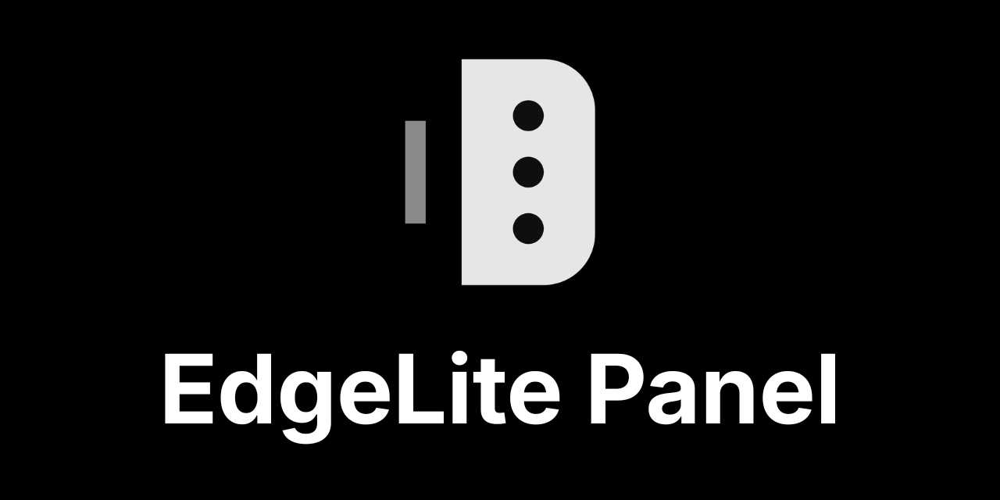
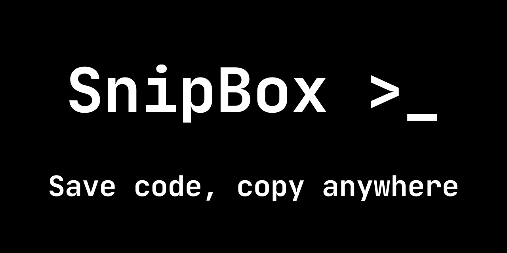

<picture>
  <source media="(prefers-color-scheme: dark)" srcset="https://readme-typing-svg.demolab.com?font=Fira+Code&weight=500&size=20&duration=3000&pause=1000&color=FFFFFF&center=true&vCenter=true&width=520&lines=Student+%26+Linux+enthusiast;Building+tools+for+Android;Kotlin+%7C+Android+%7C+Open+Source" />
  <source media="(prefers-color-scheme: light)" srcset="https://readme-typing-svg.demolab.com?font=Fira+Code&weight=500&size=20&duration=3000&pause=1000&color=000000&center=true&vCenter=true&width=520&lines=Student+%26+Linux+enthusiast;Building+tools+for+Android;Kotlin+%7C+Android+%7C+Open+Source" />
  
</picture>

---

## `$ whoami`

Hi, I'm **Arion**, a student who loves Linux and builds small, focused tools for Android.
I like apps that are lightweight, offline-first, and respect user privacy.

## `$ ls projects/`

### 🧩 [EdgeLite-Panel](https://github.com/arionacc/EdgeLite-Panel)

Brings back the Edge Panel experience on Samsung devices that no longer support it.

---

### 📋 [SnipBox](https://github.com/arionacc/SnipBox)

Snippet manager with a floating bubble. Offline, no internet permission.

---

### 🌱 Currently learning

Advanced Kotlin, Jetpack Compose, modern Android architecture.

## `$ cat stack.txt`

---

## `$ contribute`

I enjoy contributing to open source. If you have an idea or found a bug in my projects, feel free to open an issue or send a pull request!

---
